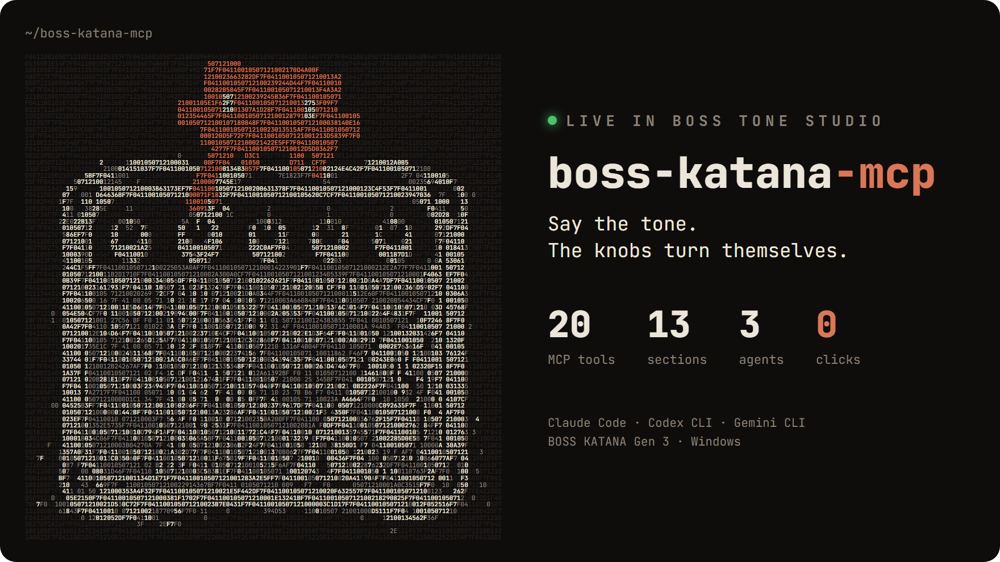
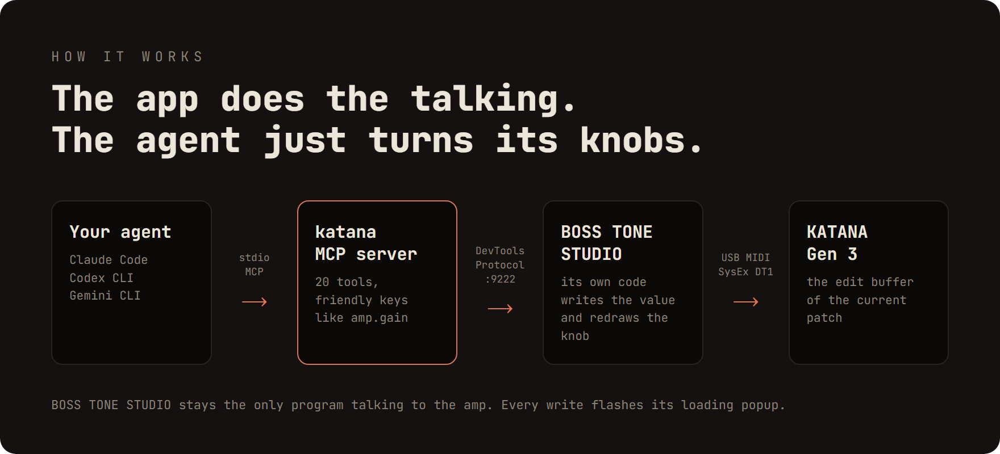

<p align="center">
  <picture>
    <source media="(prefers-color-scheme: dark)" srcset="assets/logo-dark.png">
    
  </picture>
</p>

<h1 align="center">boss-katana-mcp</h1>

<p align="center">
  <em>Say the tone. The knobs turn themselves.</em>
</p>

<p align="center">
  
  
  
  
  
  
  
  
  <a href="CONTRIBUTING.md"></a>
</p>

<p align="center">
  
</p>

Talk to your **BOSS KATANA Gen 3** from [Claude Code](https://claude.com/claude-code),
[Codex CLI](https://github.com/openai/codex) or [Gemini CLI](https://github.com/google-gemini/gemini-cli).
Describe a tone and the knobs in **BOSS TONE STUDIO** move live, as if you had turned them yourself.

---

## Demo

### "write a thrash metal tone"

<p align="center">
  
</p>

### "write blues tones with long sustain and delay"

<p align="center">
  
</p>

<p align="center">
  
</p>

<p align="center">
  
</p>

## Install

### Experimental Gen 1 support

KATANA-50 Gen 1 has an isolated, **experimental** direct MIDI backend. Its
**read-only adapter path was verified on one operator-labelled KATANA-50 Gen 1**
on 2026-10-23: identity matched, all 20 addresses read successfully in 23
transactions, start/end sentinels matched and ports closed cleanly. Firmware
remains unknown; this is not a compatibility claim for other devices/firmware.
Default startup and the existing Gen 3 tools are unchanged. Set
`KATANA_BACKEND=gen1` to expose `katana_gen1_*` tools; hardware access is **off by
default**, including discovery. Status and parameter listing work without a device.
The optional native dependency is installed by `npm install`.

The original 20 reads are retained; 11 additional source-backed effective controls
were read during a later **explicitly approved metal-tone application on the same
device**. That session passed identity, 70 RQ1, nine temporary DT1 writes with
readback, and clean disconnect. It did not save a patch or alter firmware.
Audible quality, other firmware and physical fault recovery remain unverified.

`katana_gen1_apply_tone {"name":"metal"}` previews with **zero I/O** by default.
Applying requires `dryRun:false`, a connection and both write/low-MASTER startup
opt-ins. Bounded effective amp/Gain/EQ/effect-toggle/NS1 controls are also available
through `katana_gen1_set`. Temporary LEVEL is capped at 10; the metal recipe ends
at `min(previous LEVEL,5)`. Keep physical MASTER low. All panel/system, patch-save
and firmware writes remain blocked; Gen 3 tone recipes do not apply to Gen 1.
See [write support and its source evidence](docs/gen1-write-support.md) and the
[approved physical session report](docs/gen1-hardware-metal-2026-10-23.md).

The later operator-commanded delay/reverb extension adds `DelayLevel` and bounded
`ReverbLevel` writes (0..50): 32 readable keys, 16 writable effective controls.
Both effects ON and wet levels 15 passed readback on the recorded device; audible
quality remains unverified. Details are in the [command journal](docs/gen1-user-command-log.md).

See [architecture and source evidence](docs/gen1-architecture.md),
[compatibility and opt-ins](docs/gen1-compatibility.md), and
[test plan](docs/gen1-test-plan.md). The
[physical read-only report and raw evidence](docs/gen1-hardware-readonly-2026-10-23.md)
include all values, checksums and an offline evidence verifier.

### Gen 3 setup

**You need:** Windows 10/11 · a KATANA Gen 3 on USB · BOSS TONE STUDIO for KATANA Gen 3 (tested 1.1.0) ·
Node.js 24+ · Claude Code, Codex CLI or Gemini CLI.

**1. Build**

```powershell
git clone https://github.com/dogakocak/boss-katana-mcp.git
cd boss-katana-mcp
npm install
npm run build
```

**2. Open BOSS TONE STUDIO's debug port** (current user, no admin; read [Security](#security) first)

```powershell
powershell -ExecutionPolicy Bypass -File scripts\Enable-BossKatanaMcp.ps1
```

**3. Register the MCP server** as `katana`

```powershell
claude mcp add katana -- node C:/path/to/boss-katana-mcp/dist/index.js   # Claude Code
codex mcp add katana -- node C:/path/to/boss-katana-mcp/dist/index.js    # Codex CLI
gemini mcp add katana node C:/path/to/boss-katana-mcp/dist/index.js      # Gemini CLI
```

<sub>Codex asks before every tool call; add `default_tools_approval_mode = "approve"` under `[mcp_servers.katana]`
in `config.toml` to skip that.</sub>

**4. Link the skill** (a junction stays in sync with the repo)

```powershell
# Claude Code
New-Item -ItemType Junction -Path "$env:USERPROFILE\.claude\skills\katana-tone" -Target "C:\path\to\boss-katana-mcp\skill\katana-tone"
# Codex CLI and Gemini CLI share .agents\skills
New-Item -ItemType Junction -Path "$env:USERPROFILE\.agents\skills\katana-tone" -Target "C:\path\to\boss-katana-mcp\skill\katana-tone"
```

Restart your CLI, switch on the amp and ask for a tone. The agent opens BOSS TONE STUDIO and connects the amp
itself.

```text
> give me an 80s hard rock lead tone
> a bit less gain, more middle
> volume 12
```

> [!NOTE]
> Changes are live edits of the current patch. Press **WRITE** in BOSS TONE STUDIO or on the amp to keep them.

## How it works

<p align="center">
  
</p>

The MCP server attaches to BOSS TONE STUDIO's WebView2 page and calls the app's own code, so the app stays the only
program talking to the amp. The `katana-tone` skill tells the agent how to turn a description into those changes.

<p align="center">
  <a href="docs/design.md"></a>
</p>

<details>
<summary><b>MCP tools</b></summary>

| Tool | What it does |
| --- | --- |
| `katana_status` | App reachable? amp connected? patch name, active variation of each effect |
| `katana_launch` | Starts BOSS TONE STUDIO with the debug port and connects the amp |
| `katana_connect` | Reconnects an open BOSS TONE STUDIO to the amp |
| `katana_get` | Reads the tone as friendly keys (`amp.gain`, `booster.type`, …) |
| `katana_set` | Sets one or more parameters at once |
| `katana_list_params` | Lists a section's keys, ranges and option names |

</details>

<details>
<summary><b>Troubleshooting</b></summary>

| Symptom | Fix |
| --- | --- |
| `BOSS TONE STUDIO is not reachable` | Run `Enable-BossKatanaMcp.ps1`, then restart BOSS TONE STUDIO |
| `ampConnected: false` | Check power and USB, then ask the agent to reconnect |
| Values look like defaults (`amp.volume 50`, patch `KATANA`) | The patch hasn't loaded yet; wait for `ampConnected: true` |
| `running without the debug port` | Close BOSS TONE STUDIO and let the agent start it |
| Port 9222 already in use | Close the other tool using it (e.g. a browser with remote debugging) |

</details>

<details>
<summary><b>Development</b></summary>

```powershell
npm test           # unit tests (needs BOSS TONE STUDIO installed and started once)
npm run test:e2e   # against a running BOSS TONE STUDIO with the amp connected
python assets/src/build.py   # rebuild the README images (Pillow + Edge)
```

</details>

## Security

> [!WARNING]
> `Enable-BossKatanaMcp.ps1` makes BOSS TONE STUDIO **always** open a DevTools port on `127.0.0.1:9222`. While the
> app is open, any local process can control it through that port. Run `scripts\Disable-BossKatanaMcp.ps1` when you
> don't need it.

## Contributing

Issues and pull requests are welcome: tests on other KATANA Gen 3 models, better tone recipes for the skill, new
skill evals, setup notes for other agents. See [CONTRIBUTING.md](CONTRIBUTING.md) to get started.

## License

[MIT](LICENSE) © 2026 Doğa Koçak. A hobby project, made for fun and without any commercial intent.

<sub>Not affiliated with or endorsed by Roland / BOSS or Anthropic. "BOSS", "KATANA" and "BOSS TONE STUDIO" are
trademarks of Roland Corporation; the mascot in the logo is Anthropic's Claude Code character. No Roland files are
included in this repository.</sub>
