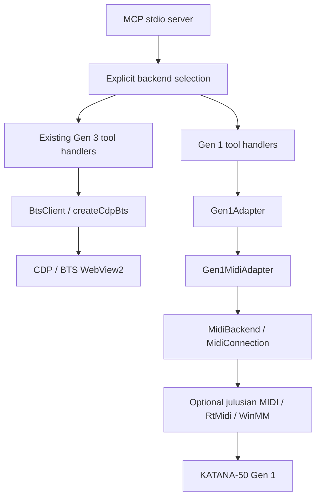

# Experimental KATANA-50 Gen 1 architecture

Current extension: [bounded temporary writes and a metal-tone plan](gen1-write-support.md)
add one Gen 1 tool and `tones.ts` without changing any Gen 3 implementation.
The source-comparison table below records the original integration decisions;
its earlier gain-pair/NS1 write restrictions are superseded by the explicitly
sourced effective-control extension. Defaults remain hardware/write-disabled.

## Integration decision

The existing Gen 3 contract is a BTS UI contract: `src/bts.ts:4` exposes PID
indexing, variation colors, patch names and the BTS connect dialog. Gen 1 exposes
raw, evidenced MIDI fields, with no proven full patch map or matching semantics.
Forcing both through `BtsClient` would fabricate Gen 1 colors/PIDs/ranges.

`src/backend.ts` therefore selects the tool registrar at startup. The default is
the original Gen 3 CDP implementation. `KATANA_BACKEND=gen1` selects separate
`katana_gen1_*` tools and a small `Gen1Adapter` interface. No Gen 3 handler,
catalog, launcher, CDP or page-agent implementation was changed. This is a
smaller integration than rewriting all existing handlers around a common model.

## Modules and behavior

- `gen1/protocol.ts`: pure RQ1/DT1 encoding, strict correlated DT1 decoding,
  checksum, observed universal identity verification. No I/O.
- `gen1/parameters.ts`: immutable allowlist of 11 operational and 9 research
  reads. No arbitrary addresses, PRMID escape hatch or inferred value ranges.
- `gen1/adapter.ts`: default-closed hardware gate, physical-model attestation,
  serialized discovery/connect/read/write/disconnect, fault latch and timeout.
- `gen1/native-midi.ts`: lazily imports the optional native dependency, uniquely
  opens the selected pair, enables SysEx and removes listeners/resources.
- `gen1/tools.ts`: typed MCP schemas, separate raw semantics, structured errors.

Status and parameter listing perform no MIDI calls. Discovery enumerates only;
connect sends one identity inquiry. Model identification requires both the observed
Roland family/member AND an operator's physical KATANA-50 Gen 1 confirmation.
No automatic device fallback between generations occurs.

Every command waits on one adapter queue. A write's pre-read, DT1 and readback
occupy the queue as one transaction. A native process-wide owner prevents two
adapters opening the ports simultaneously. Other MIDI applications must be closed;
this implementation does not share TONEFORGE's Windows named mutex or enforce a
system-wide lock. WinMM errors are returned as failures, not successful changes.

An I/O/identity/response fault closes ports and permanently latches that adapter.
Queued commands recheck the latch. No retry, implicit reconnect, rollback or fault
reset tool is provided. After inspecting amp state, physically reconnect USB and
restart the server. A clean explicit disconnect permits reconnect and a fresh
identity check. Server restart alone cannot prove that a late device reply was
flushed. Status is cached, not a live unplug detector.

The native API sends synchronously; JavaScript timers cannot interrupt a hung
native driver call. Response waits are bounded, but native open/send/close driver
hangs remain a hardware qualification item. Fragmented DT1 reassembly is not
implemented here. Wrong or unrelated SysEx conservatively faults the session.
Unsolicited same-address notifications cannot be distinguished from RQ1 responses
by this protocol. Matching readback is not a formal ACK or persistence proof.

## Read-only physical qualification

The existing adapter/native path at revision
`c5ac085f1849157e8fcddfdc30e388bf6cf31540` passed an explicitly authorized physical
read-only run on 2026-10-23: observed identity, 20 unique addresses / 23 reads,
matching sentinels and clean disconnect. The harness used the existing adapter
with real native classes and an exact outgoing identity/RQ1 guard. It did not
exercise physical MCP stdio, unplug/reconnect or write behavior. No runtime
source or safety gate changed. Full evidence, source/build hashes, raw values and
limitations are in the [hardware report](gen1-hardware-readonly-2026-10-23.md).

## Local application analysis (read-only)

Source root supplied by the operator: `C:/Users/ozkar/Documents/ChatGPT/musicplayer`.
References below are relative to that root; line numbers refer to the inspected
snapshot. Its files were untracked and no remote was configured. No source file
was moved, edited or copied. SHA-256 evidence is in `gen1-source-manifest.json`.

| Finding | Source evidence | Integration implication |
| --- | --- | --- |
| Independent Roland codec; identity and DT1 parsing | `src/ToneForge.Protocol/RolandSysEx.cs:42`, `:58`, `:74`, `:96`, `:116` | Fresh TS codec validates framing, 7-bit data, checksum, device/model/address/size |
| Device ID 00, four-byte model 00 00 00 33, 2s read timeout | `src/ToneForge.AppCore/ParameterCatalog.cs:32` | Fixed observed profile; no invented universal model constants |
| Eleven independently readable addresses | `src/ToneForge.AppCore/ParameterCatalog.cs:38` | Separate panel positions/codes and temporary gain |
| Nine additional context-dependent reads | `src/ToneForge.AppCore/ParameterKnowledge.cs:200`, `:204`, `:216`, `:220`, `:222`, `:229`, `:234`, `:238`, `:257` | Explicit research flag; raw results only |
| USB presence and unique exact KATANA WinMM pair; BTS exclusion | `src/ToneForge.AppCore/KatanaAdapters.cs:43`, `:50`, `:54`, `:131`; `tools/ToneForgeMidiIdentity.cs:127`; `tools/ToneForgeMidiRead.cs:259` | New native backend uses unique exact names and inquiry; USB PID/SetupAPI and BTS process probing are NOT ported |
| Universal identity is family/member, not physical submodel | `evidence/identity-inquiry-2026-10-20.json:13`; `docs/WINMM_PARAMETER_READ_ADAPTER.md:3` | Require operator label confirmation; firmware remains unknown |
| Parameter permissions, demonstrated ranges and bounded-only writes | `src/ToneForge.AppCore/UniversalParameterRegistry.cs:71`, `:151`, `:166`, `:188` | Never infer complete 0..100 ranges from a working pair |
| Gain 96→95→96 experiment and readback | `src/ToneForge.AppCore/ParameterCatalog.cs:72`; `src/ToneForge.Gain/GainController.cs:137`; `evidence/gain-hardware-experiment-2026-10-20.json:1` | Only temporary gain raw 95/96 exposed experimentally; new TS path not hardware-verified |
| NS1 threshold 47→48→47 experiment | `src/ToneForge.AppCore/ParameterKnowledge.cs:328`; `evidence/phase45-ns1-experiment-2026-10-20.json:1` | Read supported; dedicated restore workflow not ported, so writing blocked |
| PANEL gain/volume/EQ/combined effect codes differ from DSP working values | `src/ToneForge.AppCore/ParameterKnowledge.cs:145`; `docs/GAIN_PROTOCOL.md:7`; `docs/PHASE4_DEPENDENCIES.md:25` | No Gen 3 friendly-key aliases or effect activation inference |
| Strict physical transport allowlist and reply classification | `tools/ToneForgeMidiRead.cs:68`, `:207`, `:221`, `:259` | Fixed narrow reads, not full memory scans |
| Timeout/retry policy distinguishes simulation from physical safety | `src/ToneForge.AppCore/ParameterReadEngine.cs:109`, `:125`, `:179`; `src/ToneForge.AppCore/WinMmParameterReadSessionFactory.cs:14`; `docs/WINMM_PARAMETER_READ_ADAPTER.md:15` | One attempt, fault latch and explicit reconnect; no automatic timeout retry |
| Serialized session, journal and restored gain experiment | `src/ToneForge.AppCore/KatanaAmplifierSession.cs:20`, `:167`, `:494`; `src/ToneForge.Gain/GainController.cs:161` | Queue reused as an architectural idea; journal/automatic restore are not ported |
| Presets are local draft JSON, not device patch write support | `src/ToneForge.AppCore/ToneForgePresets.cs:1`; `docs/GAIN_PROTOCOL.md:11`; `README.md:23` | No full patch read/write, selection or save API claimed |
| Offline codec and mock transport tests | `tests/Run-ProtocolTests.ps1:1`; `src/ToneForge.ParameterEngine.Validation/Program.cs:34`; `src/ToneForge.ParameterEngine.Validation/WinMmParameterReadValidation.cs:26` | New offline vectors and mocks; local tests not rerun or modified |
| Historical 23 read transactions over 20 unique addresses, 46 audit records | `evidence/phase7a-hardware-read-sweep-verified-2026-10-20.json:1` | Historical TONEFORGE evidence only; not a hardware test of this contribution |

## Licensing and dependency review

Upstream is MIT (`LICENSE`). The local project has no discovered LICENSE/COPYING
file or package-level reuse grant. Its C#/PowerShell implementation and proprietary
Roland assets were not copied or redistributed. This contribution independently
implements protocol facts and uses small observed wire vectors as test data.
The architecture/permission ideas were reused, not implementation code.

`@julusian/midi` 3.8.1 is pinned as an optional dependency. Its installed LICENSE
is MIT (Justin Latimer / Julian Waller); bundled `vendor/rtmidi/RtMidi.h` carries
Gary P. Scavone's MIT-style permission notice. npm packages retain their notices;
no library source/native binaries are vendored here. Runtime dependencies added
transitively are `node-addon-api` (MIT), `pkg-prebuilds` (MIT) and `tslib` (0BSD);
their compatible notices remain in the installed packages. Gen 3 works without the
optional MIDI package; imports are lazy and missing native binaries return an
actionable Gen 1 error. No .NET/Frida/REA runtime dependency was introduced.
